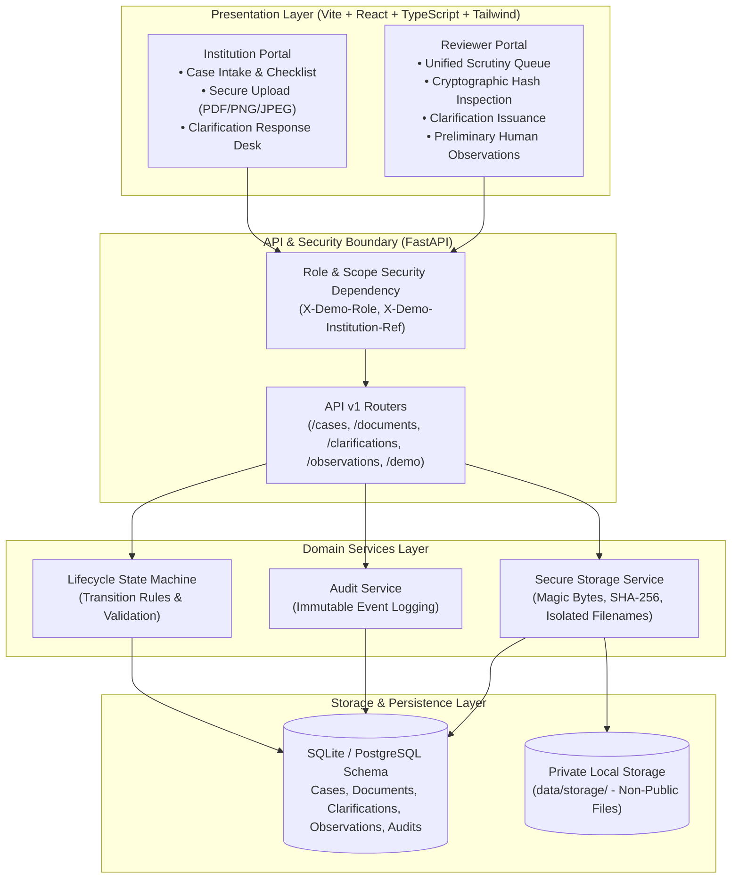
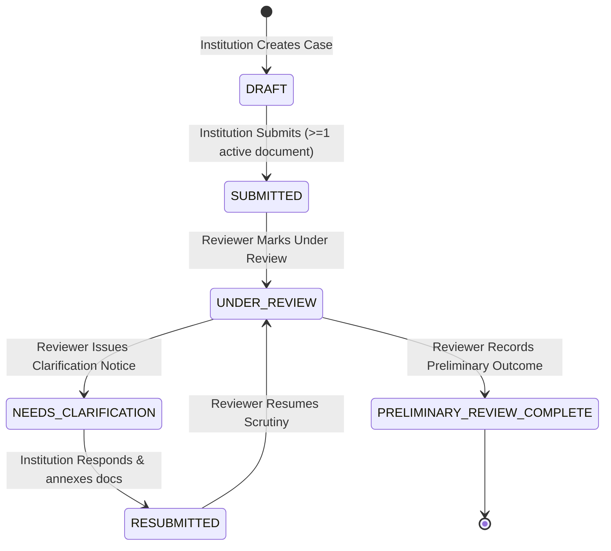
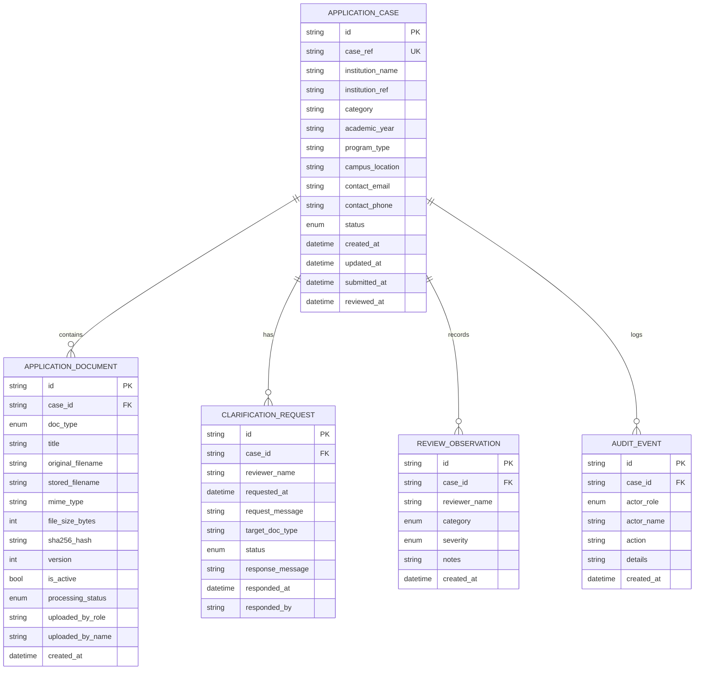

# AICTE Veritas — Architecture Document (Stage 1 Foundation)

## 1. Problem Statement Alignment

**SIH Problem Statement 26261:** *“AI-Powered Application Validation, Document Authentication and Regulatory Compliance Verification.”*

Technical institutions in India submit complex regulatory applications (such as Extension of Approval — EoA, Increase in Intake, or New Institution Establishment) to the All India Council for Technical Education (AICTE). These applications require extensive supporting evidence: registered land title deeds, previous year approval letters, faculty cadre and salary disbursement statements, and municipal fire safety occupancy certificates.

Reviewing these thousands of voluminous applications manually is time-consuming and prone to human oversight.

**AICTE Veritas** is designed as a secure, human-in-the-loop regulatory copilot. Rather than replacing statutory committee decisions or attempting fully autonomous approval/rejection, AICTE Veritas assists regulatory officers by:
1. Validating document structures and cryptographic integrity (SHA-256 fingerprints and genuine magic-byte signatures).
2. Enforcing a strict, auditable institutional application lifecycle.
3. Providing a bidirectional clarification loop between institutions and council scrutiny officers.
4. Logging an immutable audit trail of every intake, upload, and reviewer observation.

---

## 2. High-Level System Architecture

---

## 3. Application Lifecycle State Machine

AICTE Veritas enforces explicit, validated server-side state transitions. Institutions cannot alter reviewer fields or bypass review; reviewers cannot tamper with original institutional document contents.

### Transition Authority Matrix

| From State | To State | Authorized Role | Preconditions / Side Effects |
| :--- | :--- | :--- | :--- |
| `DRAFT` | `SUBMITTED` | `institution` | Requires at least 1 active supporting document uploaded. |
| `SUBMITTED` | `UNDER_REVIEW` | `reviewer` | Case locked from institutional edits. Audit event logged. |
| `UNDER_REVIEW` | `NEEDS_CLARIFICATION`| `reviewer` | Reviewer supplies deficiency description. Clarification created with `OPEN` status. |
| `NEEDS_CLARIFICATION`| `RESUBMITTED` | `institution` | Institution submits explanation and may upload revised document versions. |
| `RESUBMITTED` | `UNDER_REVIEW` | `reviewer` | Reviewer acknowledges response and resumes scrutiny. |
| `UNDER_REVIEW` | `PRELIMINARY_REVIEW_COMPLETE` | `reviewer` | Reviewer records preliminary scrutiny findings and notes. |

---

## 4. Data Model and Entity Relationships

---

## 5. Security & Trust Architecture

1. **Server-Side Access Isolation:** Every protected API route enforces role validation via FastAPI dependency injection. Institution representatives can access only application cases mapped to their registered institution ID (`institution_ref`). Attempted cross-access triggers `403 Forbidden`.
2. **File Signature & Magic-Byte Verification:** Uploaded files are inspected for authentic binary signatures (`%PDF` for PDF, `\x89PNG\r\n\x1a\n` for PNG, and `\xff\xd8\xff` for JPEG). Renaming an `.exe` or `.txt` to `.pdf` is immediately blocked with `400 Bad Request`.
3. **Isolated Private Storage:** Uploaded files are assigned cryptographic UUID filenames (`[uuid4].[ext]`) and saved in a dedicated local private folder (`backend/data/storage/`), completely isolated from the web root. No public URLs exist; access requires authorized backend streaming routes (`/download`).
4. **Cryptographic SHA-256 Hashing:** The backend computes a SHA-256 digest on every uploaded document stream. Identical document hashes across multiple institutions trigger a duplicate warning signal for reviewers.
5. **Separation of Concerns:** In Stage 1, demo roles are clearly isolated behind a clean authentication provider dependency (`get_current_actor`), ready to be replaced with OAuth2/JWT or DigiLocker institutional single sign-on in production.

---

## 6. Roadmap: Evolution to Future Stages

| Component | Stage 1 (Delivered Foundation) | Stage 2 (Planned Next Steps) |
| :--- | :--- | :--- |
| **Document Intake** | Magic bytes, SHA-256 hash, size validation, versioning | PDF multi-page text extraction and Tesseract OCR fallback |
| **Validation** | Format integrity, required checklist completeness | Cross-document field comparison (e.g. Survey No. in deed vs EoA) |
| **Rules Engine** | Server-side lifecycle state machine transitions | Versioned regulatory compliance rules (APH 2026-27 ruleset) |
| **Verification** | Cryptographic fingerprinting & duplicate detection | Issuing authority connectors (DigiLocker, State Fire Dept APIs) |
| **Reviewer Assist** | Preliminary observations & clarification desk | Evidence-linked discrepancy snippets & advisory findings |
| **Authentication** | Demo role simulation with server-side enforcement | AICTE Single Sign-On (SSO) / OAuth2 / PKI digital signatures |
